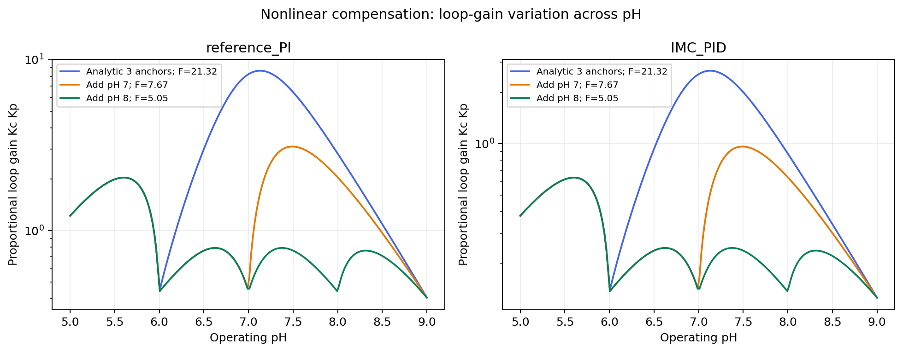

# CSTR pH controller comparison

This repository contains the notebooks and simulation results from my CSC421 research project on pH control in a lab-scale CSTR. The main question is how well different controllers compensate for changes in process gain, and how that compensation relates to setpoint tracking.

## See the loop-gain flatness versus operating pH graph

[Open the graph](output/compensation_vs_tracking/loop_gain_vs_pH.png), or view it below. You can see the saved results without running the notebook.



The graph shows how proportional loop gain changes with operating pH. Here, `L_P(pH) = Kc(pH) Kp,local(pH)`: the controller gain multiplied by the local process gain. A flatter curve means that the controller compensates more evenly across the pH range. The legends give `F = max(L_P)/min(L_P)` over pH 5–9. Perfectly constant gain gives `F = 1`.

When the curve is normalised to a reference value, ideal compensation gives a flat line at one. The absolute loop gain can have a different value. Its level still matters for tracking, so I compare compensation with tracking error rather than use flatness alone to choose a controller.

The calculation is in **Section 6: Central result: loop-gain flatness and nonlinear gain compensation** of the [main notebook](Lab_Scale_CSTR_Simulation_2_corrected.ipynb). The saved graph also appears near the end, under **Loop-gain flatness versus operating pH — saved graph**. The [Section 6 summary figure](output/loop_gain_flatness/loop_gain_flatness.png) shows process gain, controller gain and loop gain together.

## Using the notebooks

- [Main controller comparison](Lab_Scale_CSTR_Simulation_2_corrected.ipynb)
- [Separate experiment on gain-schedule anchors](CSTR_Schedule_Cause_Separation.ipynb)

To use Google Colab, download a notebook and choose **File → Upload notebook**. The figures and helper functions are included in the notebook. Download the full repository if you also want to run the scripts in `robustness/`.

For a local installation, use Python 3.11 or 3.12:

```sh
python -m venv .venv
source .venv/bin/activate
python -m pip install -r requirements.txt
python -m jupyterlab
```

Run the main notebook from the beginning. The tuning sweeps and closed-loop simulations can take some time.

After running through Section 6, you can try your own gain function in the **User-supplied controller: static compensation diagnostic** near the end. Set `USER_GAIN` to a constant, a gain scheduler or a function of pH. The supplied example copies C4b so that the cell can run before you add your own controller.

This test compares the candidate with the three reference controllers with the smallest flatness ratios, using 20,001 points between pH 5 and 9. It shows both absolute and normalised loop gain. The shaded ±10% band is an adjustable comparison tolerance. To assess tracking, the complete controller also needs to be run in the closed-loop scenarios.

## Results and supporting files

- `output/` contains the saved figures, tables and reports.
- `output/original_schedule_ablation/design_manifest.csv` records the controller schedules used in the analysis.
- `robustness/` contains the scripts for the compensation and numerical checks. See its [README](robustness/README.md) for the procedure.
- `images/notebook/` contains figures exported from notebook outputs.
- [ASSETS.md](ASSETS.md) lists the figures with previews and download links.
- `MANIFEST.sha256` contains file checksums.

The saved figures come from previous runs. They will not refresh automatically when you rerun the notebook, and the analysis scripts can overwrite output files. The separate anchor experiment uses a simplified simulator; the validation scripts use the main notebook's simulator.

The results describe the models, scales and tuning choices tested here. The numerical checks did not establish convergence across the tested sampling intervals or robustness across the full uncertainty set. These limits are discussed in Section 11.

A reuse licence has not yet been added.
